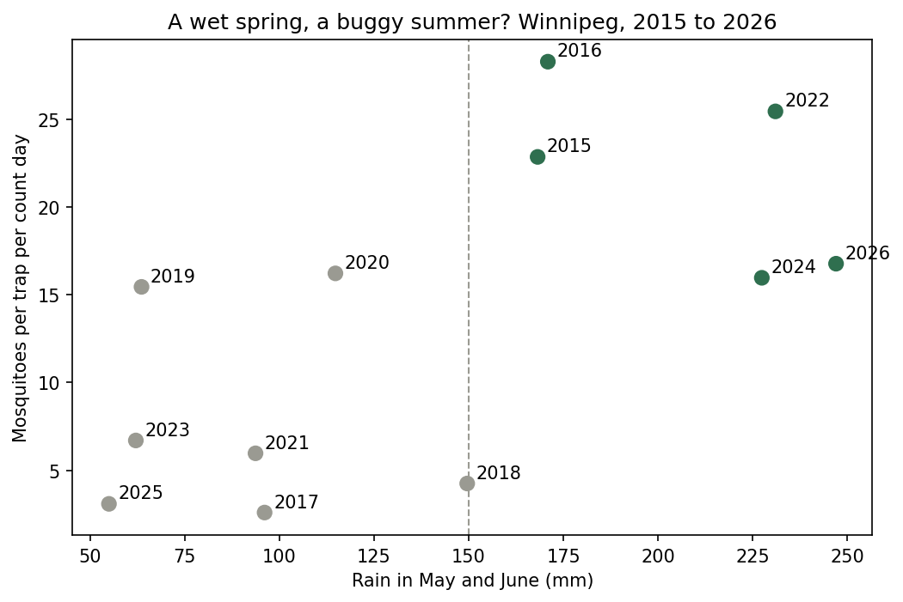

# The Provincial Bird: Is It the Rain?

Winnipeg's worst mosquito summers mostly follow wet springs: four of the five buggiest of
twelve summers had 150 mm or more of rain in May and June. But 2026, the wettest spring of
all, made only a middling-to-bad summer: rain is a warning, not a forecast.

## Data

- **Mosquito trap counts**: City of Winnipeg Open Data, *Daily Adult Mosquito Trap Data*,
  https://data.winnipeg.ca/d/du7c-8488. One row is a count day. 2015-2025 was exported 2026-09-13 for Assignment 1
  (`earlier-work/a1-mosquitoes/data/raw/`); newer seasons go in `data/raw/traps/`. Open Government Licence - Winnipeg.
- **Weather**: Environment and Climate Change Canada, daily data for WINNIPEG THE FORKS (station 28051),
  https://climate.weather.gc.ca, downloaded 2026-11-07, one CSV per year in `data/raw/weather/`. One row is a day.
  Open Government Licence - Canada.

## How to run it

Needs pandas and Matplotlib. From `notebooks/`, Restart & Run All in order:

1. `01-explore.ipynb` (first look at the weather)
2. `02-clean.ipynb` (writes `data/clean/daily.csv` and `seasons.csv`)
3. `03-story.ipynb` (the story)

**A new season:** put the trap file in `data/raw/traps/` and that year's weather file in `data/raw/weather/`, run 2
then 3, and read the story against its Key numbers cell. Nothing else changes.

## Code that runs more than once (`notebooks/mosquito_tools.py`)

| Function | Why it's a function |
|---|---|
| `count_repeats` | The one-row check, on both datasets and every release |
| `unmatched` | Two joins need it: count days to weather, summers to spring rain |
| `ranked_bars` | From my A2 report; chapters 1 and 2 both draw one |
| `side_averages` | Chapter 2's chart and the key numbers both need the four sides |
| `is_wet` | One definition of a wet spring, for the chart colours and the key numbers |
| `key_numbers` | Run before and after every new season, to see which numbers moved |
| `load_releases` | Every new season is a new file; it stops if two files overlap |
| `rain_scatter` | Chapter 3 and the README figure draw the same chart |
